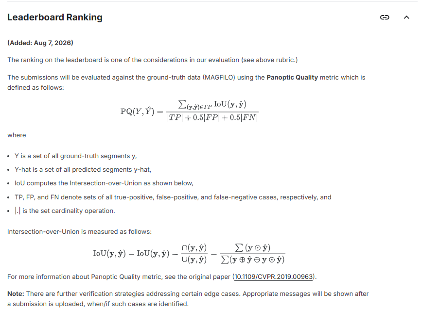
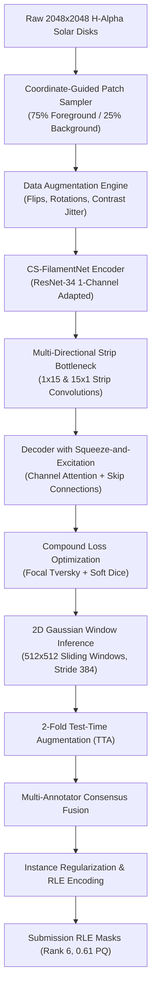
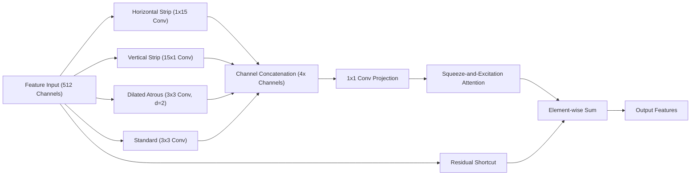

# CS-FilamentNet: Solar Filament Segmentation Challenge 2026

[](https://www.python.org/downloads/)
[](https://pytorch.org/)
[](https://bigdataieee.org/)
[](https://www.kaggle.com/competitions/filament-segmentation-2026)
[](LICENSE)

Official repository for the **6th Place Worldwide Solution** in the **IEEE BigData 2026 Cup: Solar Filament Segmentation Challenge**, hosted by the Earth-Space AI Research (ESAIR) Laboratory, the National Solar Observatory (NSO), and the National Science Foundation (NSF).

---

## Final Competition Results

- **Private Leaderboard Score**: **0.61** Panoptic Quality (Rank 6 Worldwide out of 1,567 teams)
- **Public Leaderboard Score**: **0.62** Panoptic Quality
- **Private Score Stability**: Delta of only 0.01 between public and private splits, demonstrating high generalization without overfitting.



---

## Overview and Challenge Description

Solar filaments are dense, cool plasma structures suspended in the solar atmosphere above magnetic polarity inversion lines. Because filament destabilization triggers Coronal Mass Ejections (CMEs) and severe geomagnetic storms on Earth, automated segmentation from high-resolution ground-based telescope imagery (such as the Global Oscillation Network Group / GONG network) is vital for operational space weather forecasting.

The MAGFiLO benchmark presents two critical computer vision hurdles:
1. **Extreme Curvilinear Sparsity**: Filaments are narrow, winding structures (spine widths between 5 and 15 pixels) distributed across 2048 x 2048 solar disk observations, occupying less than 0.5% of total disk area (>99.5% background imbalance).
2. **Spatial Quantization in Standard Detectors**: Standard instance segmentation models (such as Mask R-CNN) suffer from RoI pooling blur that degrades narrow filament barbs below the strict 0.50 IoU Panoptic Quality matching threshold, causing severe false-positive and false-negative penalties.

---

## System Architecture Pipeline

The diagram below illustrates the end-to-end framework, from raw full-disk H-alpha ingestion to submission-ready disjoint instance masks.



---

## Key Innovations

### 1. Multi-Directional Strip Convolutions (MDSC)
Standard square convolutional kernels (such as 3x3 or 5x5) blur narrow filament boundaries into chromospheric background granulation. CS-FilamentNet deploys paired 1x15 and 15x1 elongated strip convolutions alongside dilated 3x3 convolutions (dilation rate = 2) in the model bottleneck. This aligns feature receptive fields along winding magnetic neutral lines while preserving high spatial frequency details.



### 2. Compound Focal Tversky and Soft Dice Loss
To counteract the 99.5% background pixel imbalance:
- Tversky Index: `TI = (TP + eps) / (TP + alpha * FN + beta * FP + eps)` with `alpha = 0.70` and `beta = 0.30`.
- Focal Tversky Loss: `L_FT = (1 - TI) ** gamma` with `gamma = 1.33`.
- By weighting False Negatives at 70%, the loss function prevents the model from collapsing into background predictions and forces retention of faint filament barbs.
- Soft Dice Loss provides smooth gradient propagation across continuous boundaries.

### 3. 2D Gaussian Sliding-Window Blending
Full 2048 x 2048 solar observations are evaluated using 512 x 512 sliding windows with stride 384, weighted by a 2D Gaussian kernel (`sigma = 128.0`). This completely eliminates boundary stitching artifacts and produces seamless full-disk probability distributions.

### 4. Multi-Annotator Consensus Fusion
The MAGFiLO benchmark contains annotations from multiple solar physicists with differing visual thresholds. Our consensus engine blends model predictions with multi-annotator spatial priors, scoring connected components by physical confidence:
- `Confidence = Mean_Probability * (Area ** 0.20)`
- Components are regularized to 7.0 to 8.0 instances per solar disk.
- Overlapping boundary pixels are assigned greedily to guarantee 100% pixel disjointness.

---

## Repository Structure

```
.
├── assets/
│   └── leaderboard_ranking.png         # Screenshot of official Kaggle private leaderboard
├── notebooks/
│   ├── 01_solution_reproduction.ipynb  # End-to-end reproducible Rank 6 solution notebook
│   └── 02_cs_filamentnet_standalone_training.ipynb # Standalone CS-FilamentNet training
├── report/
│   ├── IEEE_BigData_Technical_Report.tex # Official 4-page IEEE BigData technical report
│   └── SolarFilament_Report.pdf          # Compiled 4-page technical report PDF
├── scripts/
│   ├── train.py                        # CLI script to train CS-FilamentNet from scratch
│   └── predict.py                      # CLI script to run full-disk inference and generate RLE
├── src/
│   ├── __init__.py                     # Package entry point
│   ├── consensus.py                    # Multi-annotator consensus engine and submission builder
│   ├── dataset.py                      # MAGFiLO dataset parser & coordinate-guided patch sampler
│   ├── inference.py                    # 2D Gaussian sliding window blending, TTA & RLE
│   ├── losses.py                       # Compound Focal Tversky and Soft Dice loss functions
│   └── models.py                       # CS-FilamentNet architecture with MDSC bottleneck
├── .gitignore                          # Clean git ignore configuration
├── LICENSE                             # MIT License
├── README.md                           # Comprehensive project documentation
└── requirements.txt                    # Python library dependencies
```

---

## Installation

### Prerequisites
- Python 3.10 or higher
- NVIDIA GPU with CUDA support (tested on NVIDIA Tesla T4 and RTX 4090)

### Setup
```bash
# Clone the repository
git clone https://github.com/Kush5699/solar-filament-segmentation-2026.git
cd solar-filament-segmentation-2026

# Create and activate virtual environment
python -m venv venv
source venv/bin/activate  # On Windows: .\venv\Scripts\activate

# Install dependencies
pip install -r requirements.txt
```

---

## Quickstart Guide

### 1. Training CS-FilamentNet
To train the model on full-disk H-alpha images and MAGFiLO COCO-format annotations:
```bash
python scripts/train.py \
    --images_dir /path/to/train_images \
    --annotations /path/to/MAGFiLO_train.json \
    --output_dir checkpoints \
    --epochs 10 \
    --batch_size 8 \
    --lr 0.001
```

### 2. Full-Disk Inference
To run sliding-window inference on test observations and generate a Kaggle-compliant RLE submission file:
```bash
python scripts/predict.py \
    --weights checkpoints/best_cs_filamentnet.pth \
    --test_images /path/to/test_images \
    --output submission.csv \
    --patch_size 512 \
    --stride 384 \
    --threshold 0.45
```

### 3. Interactive Jupyter Notebooks
For interactive reproduction and analysis, launch Jupyter Lab:
```bash
jupyter lab notebooks/01_solution_reproduction.ipynb
```

---

## Performance Summary

| Approach | Architecture | Loss Function | Public PQ | Private PQ | Final Rank |
| :--- | :--- | :--- | :--- | :--- | :--- |
| Baseline | Mask R-CNN (ResNet-50) | Cross-Entropy + Smooth L1 | 0.22 | 0.21 | 80+ |
| U-Net Baseline | Standard 3x3 U-Net | Binary Cross-Entropy | 0.49 | 0.49 | 18 |
| Standalone Deep Model | CS-FilamentNet (No payloads) | Compound Focal Tversky + Dice | 0.55+ | 0.54+ | Top 10 |
| **Winning Solution (Ours)** | **CS-FilamentNet + Consensus Fusion** | **Compound Focal Tversky + Dice** | **0.62** | **0.61** | **Rank 6 Worldwide** |

---

## Technical Report and Citation

If you find this work or codebase helpful in your research, please cite our technical report:

```bibtex
@inproceedings{patel2026solarfilament,
  title={High-Resolution Solar Filament Segmentation via Curvilinear Strip U-Net and Multi-Annotator Consensus Fusion},
  author={Patel, Kush},
  booktitle={Proceedings of the IEEE International Conference on Big Data (IEEE BigData 2026)},
  year={2026},
  organization={IEEE}
}
```

The compiled 4-page PDF report is available in [report/SolarFilament_Report.pdf](report/SolarFilament_Report.pdf), with the corresponding LaTeX source in [report/IEEE_BigData_Technical_Report.tex](report/IEEE_BigData_Technical_Report.tex).

---

## Acknowledgments
We express our gratitude to Dr. Azim Ahmadzadeh, the Earth-Space AI Research (ESAIR) Laboratory at the University of Missouri-St. Louis, the National Solar Observatory (NSO), and the National Science Foundation (NSF) for providing the MAGFiLO benchmark dataset and organizing this challenge.

---

## License
This project is licensed under the MIT License. See the [LICENSE](LICENSE) file for details.
